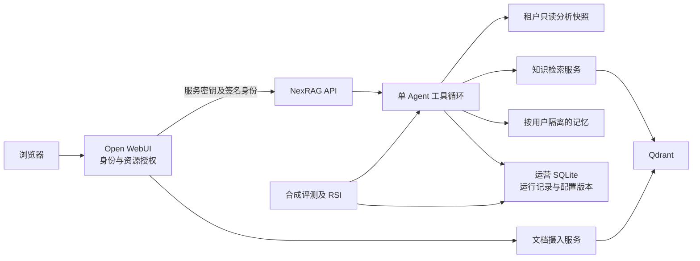

# 架构与代码职责

NexRAG 在本机运行一个受授权工具约束的 Agent，联合查询知识文档和只读业务数据。网页复用固定版本的 Open WebUI，摄入与检索复用保留原许可的 AarhusAI 服务。

## 模块边界

| 目录 | 职责 |
| --- | --- |
| `src/api/` | 校验请求身份和管理员角色，提供聊天、工作空间、租户、评测与记忆接口 |
| `src/agent/` | 执行模型工具循环、构建授权上下文、收集证据、校验答案与导出 |
| `src/midplatform/` | 只读数据源、快照、SQL 检查、租户与资源授权、模型/MCP 注册、运营存储 |
| `src/rag/` | 原生文档读取和父子块切分 |
| `base/ingestion-service/` | 文本及向量摄入 |
| `base/retrieval-agent/` | Dense + BM42/RRF 召回、BGE 重排和 Parent 展开 |
| `src/evaluation/`、`src/evolution/` | 合成实验、候选生成、门控及版本生命周期 |
| `src/memory/` | 用户记忆的提取、召回、冲突消解、遗忘和补偿 |
| `scripts/` | 原生进程启动、固定依赖准备、诊断、评测和发布检查 |
| `patches/open-webui/` | 固定上游提交上的可重放网页及桥接修改 |

HTTP 路由负责解析输入和映射错误。权限规则、查询契约和版本变更集中在所属模块，避免在多个界面或路由内重复实现。

## 请求与数据

1. Open WebUI 校验会话和资源访问权，向核心服务发送共享密钥与签名身份。
2. 核心服务重新核对业务租户、知识范围和模型/工具的数据外发策略。业务租户选择不会扩大知识权限。
3. 业务工具连接只读源，将当前授权行放入隔离快照。SQL 经过 AST 检查，源库只读权限和快照共同约束访问。
4. 检索仅为 Child 存储 Dense/BM42 向量，Parent 正文放入 Child 的 Payload。重排后再展开 Parent，按来源去重。
5. Agent 收集同轮工具证据，校验数字、引用和导出内容后返回答案。运营记录与业务库分别存储。

个人知识和记忆按所有者隔离。文件操作限定在受控目录，下载时再次校验当前身份。具体规则见 [数据可信边界](data-trust-boundaries.md) 和 [安全说明](../SECURITY.md)。

## 评测与 RSI

评测与生产共用 Agent 执行代码，评测只接入合成夹具。优化器只读取合成训练失败，通过独立门控后生成待审候选。灰度和晋升由管理员控制，版本与状态更新在同一 SQLite 事务中完成。见 [评测与 RSI](evaluation-and-rsi.md)。

## 维护约定

项目自有注释使用中文，模型指令使用英文，上游文件保留原有语言。先定位规则所属模块，再修改调用入口。函数说明应交代权限、数据粒度和失败处理，避免逐行复述代码。代码与验收结果见 [参与维护](../CONTRIBUTING.md) 和 [交付状态](delivery-status.md)。
