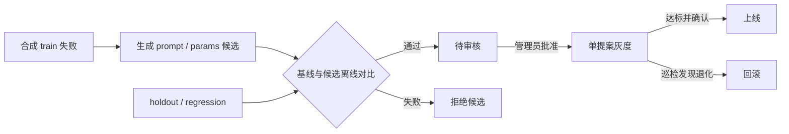

# 评测与受控自我改进（RSI）

NexRAG 用合成数据评估 Agent 的工具调用、回答、SQL、来源和安全边界。RSI 使用其中的训练失败生成带版本的提示词或参数候选，候选须经独立门控和管理员审批才能上线。长期记忆是独立的个人功能。见 [长期记忆](long-term-memory.md)。



## 评测

- `train` 用于归类失败和挑选参数候选。 `holdout` 衡量独立样本收益。 `regression` 检查已经通过的历史用例。
- 仓库种子含 13 条人工合成样本。CLI 导入种子，管理员也可在「模型评价 → NexRAG → 合成评测」添加样本。旧版保存的 holdout 和 regression 失败记录会在挖掘和生成证据时被排除。
- 评测复用生产 Agent 的运行与校验代码，使用隔离的 SQLite 数据和固定合成文档。管理员网页只可选已登记的本地模型。真实对话、业务库、知识库和导出目录均不进入共享评测。
- `src/evaluation/evaluators.py` 用确定性规则打分。质量分取本条适用的成功率、工具覆盖和约束、答案匹配、SQL 行匹配、来源命中等分数的平均值。安全、工具错误率和耗时单列。重复运行时取平均，安全违规取最坏值。见 [合成评测规则](acceptance/evaluation-rules.md)。
- 公开领域发布验收从空知识库和原始文档开始，走正式上传、自动摄入和问答接口。公开原题及官方标注用于自动评分，单独判断检索、生成、引用和性能门槛。见 [RAG 发布验收](acceptance/rag-quality-targets.md)。

```powershell
uv run python scripts/run_experiment.py --splits train holdout regression --repeats 2 --record-synthetic-failures
uv run python scripts/evolve.py
```

第一条命令导入种子并运行评测，只有训练失败可以进入 RSI。第二条命令运行一次维护、灰度巡检和候选评估。后台也可手动触发。

## RSI

1. **生成候选**。 `src/evolution/miner.py` 按缺失工具或评测失败归类，同一样本只计一次。达到最小簇规模后，本地模型可根据合成训练失败调整操作指引。参数搜索只在 train 上比较有界邻居。安全前缀、租户边界、工具白名单和只读策略由代码维护。
2. **离线门控**。 `gate.py` 要求样本和三个划分齐全、候选零安全违规、已通过的回归项继续通过、holdout 质量达到最低增益（默认 0.02）、其它 holdout 指标退化不超过阈值（默认 0.01）、平均延迟增长不超过上限（默认 20%）。报告记录完整基线版本组合和两次评测运行。
3. **人工批准与灰度**。 `governance.py` 在 SQLite 事务中更新提案状态和版本标签。每次只启动一个灰度提案，按用户 ID 哈希稳定分流。默认观察至少 3 天，基线与候选各需至少 20 条 trace。比较成功率和可用的用户评价，同一回答只计最近一次评价。
4. **晋升与回滚**。 管理员再次确认后才晋升，服务端重查基线组合和灰度指标。周期巡检发现指标跌破阈值会回滚灰度。已晋升提案只能在其候选仍是当前线上版本时手动回滚，恢复该提案记录的基线。旧报告缺少完整基线组合时，需要重新评估才能批准或晋升。

状态为 `pending_review → canary → promoted`，另有 `rejected`、`stale`、`expired` 和 `rolled_back`。生产聊天 trace 只为运营和灰度提供指标，优化器读取的是合成训练失败。

## 维护入口与验证范围

- 管理员 API 位于 `/v1/ops`，涵盖 `overview`、`traces`、`datasets`、`experiments/synthetic`、`proposals` 和 `evolution/run`。 `POST /v1/ops/feedback` 仅接受回答所属用户的评价。
- 原生启动器未内置定时巡检。当前证据覆盖合成评测、门控和受控版本切换。真实业务收益、长期灰度表现和跨部署效果需要独立数据验证。
