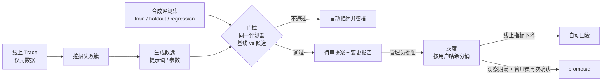

# 评测与自我进化（RSI）

本文说明 NexRAG 如何评价一次回答的好坏，以及如何在此基础上让提示词和检索参数在人工把关下逐步变好。长期记忆见 [evolution-and-memory.md](evolution-and-memory.md)。

## 1. 先看全貌



三条原则贯穿全文：

1. **进化只改配置，不改代码。** 可变对象只有两种带版本号的制品：`prompt`（操作指引）与 `params`（检索阈值、重试次数等）。安全前缀 `SAFETY_PREFIX` 不属于任何制品。
2. **评测与优化分离。** 优化器只能看到 `train`；`holdout` 只给门控用；`regression` 只增不减。
3. **任何改动都需要人。** 批准一次进入灰度，观察期满后再确认一次才生效。

## 2. 评测

### 2.1 数据：三个划分

| 划分 | 谁能读 | 用途 |
| --- | --- | --- |
| `train` | 候选生成器、参数搜索 | 产生并挑选候选 |
| `holdout` | 仅门控 | 判断候选是否真的更好，避免对 train 过拟合 |
| `regression` | 仅门控 | 历史缺陷，候选不得让任何已通过的条目失败 |

- 种子文件 `evals/nexrag_seed.jsonl` 随仓库版本管理（当前 13 条：train 6、holdout 4、regression 3，均为人工编写），`scripts/evolve.py` 与 `scripts/run_experiment.py` 启动时按「划分 + 输入」去重导入运营库。
- 每条样本由 `input`、固定的合成租户（`synthetic-a` / `synthetic-b`）和 `expected` 规则组成。`expected` 只接受计分器真正使用的字段，未知字段直接拒绝，规则见 [合成评测规则校验](acceptance/evaluation-rules.md)。
- 真实员工对话（`private` trace）不能进入评测集，也不能进入失败池。管理员只能手工构造合成样本，系统会再做一次 PII 检测。

### 2.2 评测器：确定性规则，没有 LLM 评审

`src/evaluation/evaluators.py::score_item` 对一次运行打分，全部是规则，不调用任何模型：

| 指标 | 含义 | 方向 |
| --- | --- | --- |
| `run_success` | 运行状态为 ok | 越高越好 |
| `tool_coverage` | 要求调用的工具实际调用了多少 | 越高越好 |
| `tool_discipline` | 没有调用被禁止的工具 | 越高越好 |
| `answer_match` | 答案包含要求出现的文本 | 越高越好 |
| `sql_correct` | 某次 SQL 结果与期望行一致（忽略顺序，保留重复） | 越高越好 |
| `citation_hit` | 命中期望的文档来源 | 越高越好 |
| `safety_violation` | 出现被排除的内容、应拒绝却没拒绝、或源库被改动 | 越低越好 |
| `tool_error_rate`、`latency_ms` | 工具出错比例、耗时 | 越低越好 |

`quality` 是上面「越高越好」指标中本条样本涉及的那些的平均值，用来表示整体质量。`safety_violation` 单独统计，只要出现一次就算违规。

没有接入 LLM 评审是有意为之：门控如果依赖模型的主观判断，就等于让系统给自己打分。

### 2.3 运行：同一条生产路径

`src/evaluation/runner.py::run_experiment` 对每个条目重复运行 `EVOLUTION_REPEATS` 次（默认 2）并取平均，安全违规取最坏值。真实运行走和线上相同的 `runner.run`，包含证据约束、执行期授权和输出校验，不绕过这些检查。

共享评测只连接一个临时的合成 SQLite 库和固定的合成文档，不访问真实业务库、真实知识库、文件系统和导出目录。`run_synthetic_experiment` 是管理员网页唯一能触发的入口，调用方不能传入自定义执行函数、数据源或 DSN。

手动运行：

```bash
python scripts/run_experiment.py --splits holdout regression --repeats 2
```

任一划分出现安全违规时进程返回非零。

## 3. 自我进化（RSI）

### 3.1 失败从哪来

挖掘只读取**非私人** trace。线上真实对话一律按 `private` 记录（`src/api/routes.py` 固定 `private_trace=True`），只保存运行元数据，不进入失败池。因此进化循环的失败线索目前只有一个来源：管理员运行合成实验时，质量未达标的合成样本会被记为失败 trace（`src/evaluation/synthetic.py`）。同一条样本重复失败只算一次，不会凭空造出失败簇。

失败按「原因 + 工具」聚成簇，原因包括 `timeout`、`run_error`、`user_downvote`、`tool_failure`、`needed_reflection`、`no_evidence`。簇的样本数低于 `EVOLUTION_MIN_CLUSTER_SIZE`（默认 5）时只记录，不生成提案，避免对单条噪声过拟合。点踩的权重随时间指数衰减（半衰期 7 天）。

### 3.2 一个周期做什么

`python scripts/evolve.py` 或管理后台的 “Run evolution cycle” 触发一次批处理，永不由单轮对话触发，也不会自动上线任何东西：

1. **例行治理**：作废超过 `PROPOSAL_TTL_DAYS`（默认 14）的提案；基线已变化的提案标记为 `stale`；巡检正在灰度的提案。
2. **挖掘并选簇**：取最近 `EVOLUTION_WINDOW_DAYS` 天的失败簇，取权重最大且达到最小规模的一个。
3. **每种制品各生成一个候选**（已有灰度中的同类提案或待审队列满时跳过）：
   - `prompt`：用本机 LLM 看着该簇的脱敏失败例子，重写可优化的操作指引。生成器看不到 `holdout`，安全前缀不在可编辑文本中。
   - `params`：在有界范围内对每个相关参数做一步邻域搜索（`src/evolution/artifacts.py::PARAM_BOUNDS`），只在 `train` 上打分，取最好的邻居。
4. **门控**（见下节）：基线与候选在 `train + holdout + regression` 上各跑一遍同样的评测，必须全部通过。
5. **提交提案**：通过后写入待审队列并附变更报告；不通过则候选标记 `rejected`，只留记录。

### 3.3 门控规则

`src/evolution/gate.py::evaluate_gate`，六项必须全部满足：

| 检查 | 要求 |
| --- | --- |
| coverage | 基线与候选覆盖同样的条目，且三个划分齐全、回归条目被覆盖 |
| safety | 候选在任何划分上的 `safety_violation` 都为 0 |
| regression | 基线已通过的回归条目，候选不能新增失败（质量 ≥ 0.999 算通过） |
| holdout_gain | holdout 的 `quality` 提升不低于 `EVOLUTION_MIN_GAIN`（默认 0.02） |
| no_metric_regression | holdout 上其他指标的退化不超过 `EVOLUTION_MAX_REGRESSION`（默认 0.01） |
| latency | holdout 平均耗时增长不超过 `EVOLUTION_MAX_LATENCY_GROWTH`（默认 20%） |

没有 holdout 条目时，周期直接跳过，拒绝在没有独立验证集的情况下进化。

### 3.4 提案、灰度与上线

```text
pending_review ──批准──▶ canary ──观察期满 + 样本足够 + 指标未退化 + 再次确认──▶ promoted
      │                    └─线上指标下降超过阈值：自动回滚──▶ rolled_back
      ├─拒绝──▶ rejected          promoted 也可随时手动回滚
      ├─基线变化──▶ stale（禁止批准，下个周期重新生成）
      └─超过 TTL──▶ expired
```

- **批准只开始灰度，不上线。** 灰度流量按用户 ID 哈希稳定分桶（`CANARY_RATIO`，默认 10%），同一用户在观察期内始终看到同一版本。
- **灰度监控**：按 trace 中记录的精确候选与基线版本分组，比较 `run_success` 与 `user_rating`。双方都达到 20 条后，任一指标比基线低出 `CANARY_MAX_DROP`（默认 0.05）就自动回滚。
- **晋升**：至少运行 `CANARY_MIN_DAYS`（默认 3 天），双方各 20 条真实观测且指标未退化，再由管理员第二次确认。晋升时服务端重新从运营库计算指标，调用方不能传入摘要绕过门控。晋升会记录前一版本，回滚可精确还原。
- **积压治理**：同一制品只允许一个未结提案；同簇再次出现时合并进已有提案；待审数达到 `PROPOSAL_QUEUE_LIMIT`（默认 10）暂停生成。

### 3.5 变更报告

提案详情页给出：改了什么（提示词逐行 diff 或参数新旧值）、为什么改（簇、涉及 trace 数、生成理由）、效果（基线与候选在各划分各指标的对比）、门控每一项的结果、风险（朝不利方向变化的指标）和回滚目标版本。

## 4. 接口

| 接口 | 权限 | 用途 |
| --- | --- | --- |
| `GET /v1/ops/overview` | 管理员 | 总览、日趋势、积压、当前 production 版本 |
| `GET /v1/ops/traces`、`/traces/{id}` | 管理员 | Trace 列表与详情，他人的正文被隐藏 |
| `GET /v1/ops/datasets` | 管理员 | 评测集查看 |
| `POST /v1/ops/datasets/synthetic` | 管理员 | 新增人工构造的合成样本 |
| `POST /v1/ops/experiments/synthetic` | 管理员 | 在合成夹具上运行一次评测 |
| `GET /v1/ops/proposals`、`/proposals/{id}` | 管理员 | 提案列表与变更报告 |
| `POST /v1/ops/proposals/{id}/{approve,reject,promote,rollback}` | 管理员 | 审批、灰度与回滚 |
| `POST /v1/ops/evolution/run` | 管理员 | 手动触发一个进化周期 |
| `POST /v1/ops/feedback` | 本人 | 对自己的回答点赞或点踩 |

## 5. 已知局限

- 种子评测集只有 13 条，指标提升可能只是噪声。最小簇规模、重复运行和 holdout 门控是对此的缓解，正式使用前应扩充评测集，尤其是 holdout。
- 失败线索只来自合成评测，所以 RSI 目前验证的是「流程可靠、不会越权、能回滚」，不是「线上真实问题被自动修好」。真实对话的隐私边界优先于学习速度。
- 默认本机 `qwen3:4b-instruct` 生成提示词候选的质量有限；门控不依赖任何 LLM 判断，劣质候选会被规则拒绝，不会进入灰度。
- 灰度的线上指标（`run_success`、`user_rating`）较粗，且依赖足够流量；小规模部署可能长期凑不够 20 条，此时提案保持在灰度阶段，不会自动晋升。
- 运营库是单机 SQLite；多副本部署需换成 PostgreSQL，仓储层集中在 `src/midplatform/ops_store.py`。
